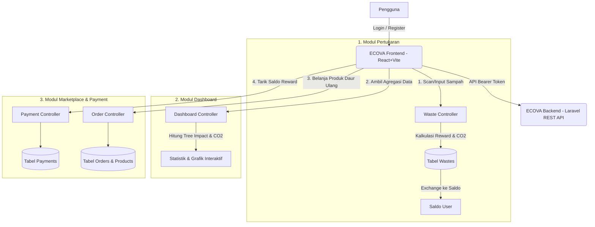

# 🌿 ECOVA – Smart Recycling Platform & Eco-Marketplace

<p align="center">
  
</p>

<p align="center">
  
  
  
  
  
  
</p>

---

## 📖 Tentang Proyek

**ECOVA** (Eco Value & Recycling Platform) adalah platform web terpadu yang dirancang untuk menjawab permasalahan penumpukan sampah anorganik melalui pendekatan **ekonomi sirkular berbasis insentif digital**.

Platform ini mentransformasi kebiasaan membuang sampah menjadi aksi bernilai ekonomi dan ekologis nyata:
1. **Daur Ulang Menjadi Saldo:** Sampah anorganik (botol PET, kardus, plastik serat, kaleng) dipindai dan dikonversi menjadi saldo tunai (*Eco-Credits/Rupiah*).
2. **Kalkulasi Dampak Lingkungan:** Setiap kilogram sampah yang disetor langsung dikalkulasikan dampaknya terhadap reduksi emisi karbon ($CO_2$) dan pohon yang diselamatkan (*tree impact*).
3. **Eco Marketplace:** Saldo yang dikumpulkan dapat ditarik tunai atau dibelanjakan untuk produk daur ulang ramah lingkungan di katalog marketplace terintegrasi.

---

## ✨ Fitur Unggulan

### 1. ♻️ Smart Waste Scanner & Pertukaran Sampah
- **Input & Scan Cepat:** Mendukung pemindaian QR code sampah atau input manual kategori sampah (Botol PET, Kardus, Serat Kertas, Plastik Fiber, Kaleng Aluminium).
- **Kalkulasi Reward Otomatis:** Konversi bobot sampah ke Rupiah secara otomatis berdasarkan tarif daur ulang terkini.
- **Keranjang Setoran Sampah:** Menampung sampah yang telah discan sebelum ditukarkan secara massal (*batch exchange*).
- **Misi Harian & Leaderboard:** Tantangan harian untuk meningkatkan engagement pengguna dan peringkat kontributor teratas (*Eco Warriors*).

### 2. 📊 Interactive Impact Dashboard
- **Dual Clustered Bar Chart:** Visualisasi komparatif data pengelolaan sampah terkelola vs belum terkelola skala nasional (2020–2026).
- **Metrik Dampak Lingkungan:** Pelacakan total kg sampah terkelola, reduksi emisi $CO_2$ (kg/ton), dan pohon yang berhasil diselamatkan secara *real-time*.
- **Live Tree Growth Card:** Indikator interaktif pertumbuhan pohon virtual berdasarkan kontribusi pengguna dengan target bulanan dinamis.
- **Donut Chart Kategori Sampah:** Visualisasi proporsi jenis sampah yang telah disetorkan.

### 3. 🛒 Eco Marketplace & Checkout
- **Katalog Produk Ramah Lingkungan:** Menampilkan produk daur ulang berkualitas (tas daur ulang, botol bambu, kompos organik, dll.) dengan filter kategori & pencarian.
- **Sistem Checkout & Donasi Pohon:** Keranjang belanja interaktif dengan opsi kode kupon diskon (`ECORUK10`, `HIJAU20`) dan program mikro-donasi penanaman pohon Rp 1.500.
- **Status Pesanan:** Pelacakan status pesanan belanja dengan riwayat transaksi.

### 4. 💳 Penarikan Saldo (Eco-Wallet)
- **Multi-Metode Penarikan:** Penarikan saldo reward ke e-wallet (DANA, GoPay, OVO), transfer bank, atau voucher belanja.
- **Halaman Konfirmasi Transaksi:** Halaman status pembayaran interaktif dengan kode transaksi dan panduan langkah berikutnya.

### 5. 🔐 Autentikasi Aman & Mode Demo Instan
- Menggunakan token autentikasi **Laravel Sanctum**.
- Dilengkapi **1-Click Demo Login** di halaman login untuk kemudahan demonstrasi penguji dan juri tanpa perlu registrasi manual.

---

## 🔐 Akun Demonstrasi (Demo User)

Untuk mempermudah pengujian saat presentasi atau demo aplikasi:

| Role | Email | Password |
| :--- | :--- | :--- |
| **Demo User** | `demo@ecoruk.id` | `password123` |

> 💡 **Tip Pengujian:** Pada halaman login, Anda dapat mengklik tombol **"Gunakan Akun Demo"** untuk mengisi formulir dan masuk ke sistem secara otomatis.

---

## 🏗️ Arsitektur & Alur Sistem (System Flow)



---

## 🛠️ Tech Stack

### Frontend
- **Framework:** React 18
- **Build Tool:** Vite
- **Routing:** React Router DOM v6
- **Chart & Visualisasi:** Chart.js, React-Chartjs-2
- **Styling:** Modular Pure CSS (Glassmorphism, Vibrant Eco Palette, Responsive Mobile/Desktop)
- **HTTP Client:** Axios & Fetch API dengan Interceptor Bearer Token

### Backend
- **Framework:** Laravel 10 (PHP ^8.1)
- **Autentikasi:** Laravel Sanctum
- **Database ORM:** Eloquent ORM
- **Database:** MySQL 8.0 / SQLite support
- **Architecture:** RESTful API dengan struktur Controller, Model, Migration, dan Seeders

---

## 📂 Struktur Direktori Proyek

```plaintext
Ecova-platform-daur-ulang/
├── frontend/                     # Aplikasi Web Client (React + Vite)
│   ├── public/                   # Asset statis & favicon
│   ├── src/
│   │   ├── components/           # Komponen UI modular (Navbar, Sidebar, Modals, Bento Cards)
│   │   ├── pages/                # Halaman utama (Landing, Login, Dashboard, Pertukaran, Marketplace, dll.)
│   │   ├── services/             # Layer komunikasi API (api.js, wasteAPI.js, marketplaceApi.js)
│   │   ├── App.jsx               # Routing & root component
│   │   └── main.jsx              # Entry point React
│   ├── package.json
│   └── vite.config.js
│
├── backend/                      # API Service (Laravel 10)
│   ├── app/
│   │   ├── Http/Controllers/    # Controller API (Auth, Dashboard, Waste, Product, Order, Payment)
│   │   └── Models/               # Model Eloquent (User, Waste, Product, Order, Payment)
│   ├── database/
│   │   ├── migrations/           # Skema tabel database
│   │   └── seeders/              # Data awal & user demo (DatabaseSeeder.php)
│   ├── routes/
│   │   └── api.php               # Definisi endpoint REST API
│   ├── composer.json
│   └── .env.example
│
├── vercel.json                   # Konfigurasi deployment frontend di Vercel
└── README.md                     # Dokumentasi utama proyek
```

---

## 🚀 Panduan Menjalankan Proyek (Local Setup)

### Prasyarat:
Pastikan perangkat Anda telah terinstal:
- **Node.js** (v18.x atau lebih baru) & `npm`
- **PHP** (v8.1 atau lebih baru)
- **Composer** (Package manager PHP)
- **MySQL** (atau SQLite untuk kemudahan pengujian lokal)

---

### Langkah 1: Clone Repositori
```bash
git clone https://github.com/syifamwlda/Ecova-platform-daur-ulang.git
cd Ecova-platform-daur-ulang
```

---

### Langkah 2: Setup & Jalankan Backend (Laravel)
Buka terminal baru di direktori root:

```bash
cd backend

# 1. Install dependensi PHP
composer install

# 2. Salin file environment
cp .env.example .env
# (Untuk pengguna Windows Command Prompt gunakan: copy .env.example .env)

# 3. Generate Application Key
php artisan key:generate

# 4. Konfigurasi database di file .env (opsional: sesuaikan DB_DATABASE, DB_USERNAME, DB_PASSWORD)
# Jika menggunakan SQLite, cukup buat file: database/database.sqlite

# 5. Jalankan migrasi dan seeder data awal
php artisan migrate --seed

# 6. Jalankan server Laravel
php artisan serve
```
> Server backend akan berjalan di: `http://localhost:8000`

---

### Langkah 3: Setup & Jalankan Frontend (React + Vite)
Buka terminal baru di direktori root:

```bash
cd frontend

# 1. Install dependensi JavaScript
npm install

# 2. Jalankan development server
npm run dev
```
> Frontend akan berjalan di: `http://localhost:5173`

Buka browser dan akses `http://localhost:5173` untuk mulai menjelajahi aplikasi!

---

## 📡 Ringkasan Endpoint REST API

| Method | Endpoint | Deskripsi | Auth |
| :--- | :--- | :--- | :---: |
| `POST` | `/api/register` | Pendaftaran pengguna baru | Public |
| `POST` | `/api/login` | Autentikasi user & pengembalian Bearer Token | Public |
| `GET` | `/api/products` | Mendapatkan daftar katalog produk ramah lingkungan | Public |
| `GET` | `/api/products/{id}` | Detail produk berdasarkan ID | Public |
| `POST` | `/api/logout` | Revoke session & token autentikasi | Sanctum |
| `GET` | `/api/dashboard` | Agregasi metrik dampak, grafik statistik, & histori | Sanctum |
| `POST` | `/api/wastes/scan` | Input/scan sampah baru ke keranjang setoran | Sanctum |
| `GET` | `/api/wastes/current` | Mengambil daftar sampah aktif yang belum ditukar | Sanctum |
| `POST` | `/api/wastes/exchange` | Menukarkan sampah terverifikasi menjadi saldo reward | Sanctum |
| `POST` | `/api/orders` | Checkout pesanan produk ramah lingkungan | Sanctum |
| `POST` | `/api/payments` | Pengajuan penarikan saldo reward (DANA / Bank) | Sanctum |
| `GET` | `/api/payments` | Riwayat penarikan saldo pengguna | Sanctum |

---

## 📸 Dokumentasi Antarmuka (Preview Tampilan)

| Beranda & Hero Section | Halaman Login & Impact Banner |
| :---: | :---: |
|  |  |

| Impact Dashboard & Analytics | Scanner & Pertukaran Sampah |
| :---: | :---: |
|  |  |

---

## 🗺️ Rencana Pengembangan (Future Roadmap)

- [ ] **AI-Powered Waste Vision:** Integrasi Machine Learning untuk klasifikasi sampah otomatis langsung dari kamera smartphone.
- [ ] **Drop-Point Dropzone GPS:** Peta interaktif penjemputan sampah dan titik drop-box ECOVA terdekat.
- [ ] **Integrasi Payment Gateway:** Pembayaran otomatis via Midtrans/Xendit untuk pencairan saldo instan.
- [ ] **Sertifikat Kontribusi Lingkungan:** Download sertifikat digital pengurang emisi karbon untuk keperluan portofolio CSR atau personal.

---

## 👥 Tim & Pengembang

Dikembangkan dengan dedikasi untuk mendukung kelestarian bumi dan masa depan yang lebih hijau 🌱.

---

## 📄 Lisensi

Proyek ini dilisensikan di bawah lisensi **MIT** – bebas digunakan untuk keperluan edukasi, demonstrasi, dan pengembangan lebih lanjut.
